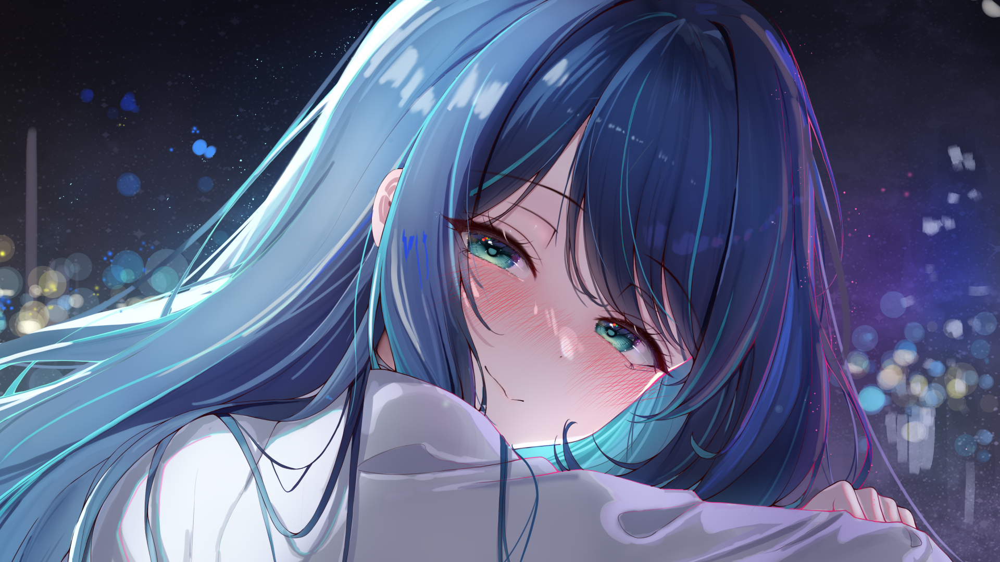
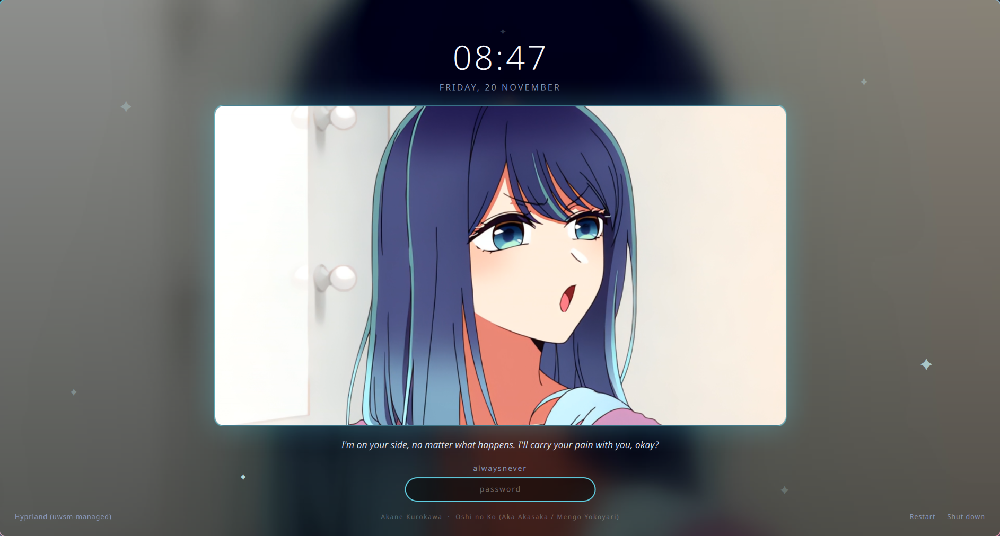
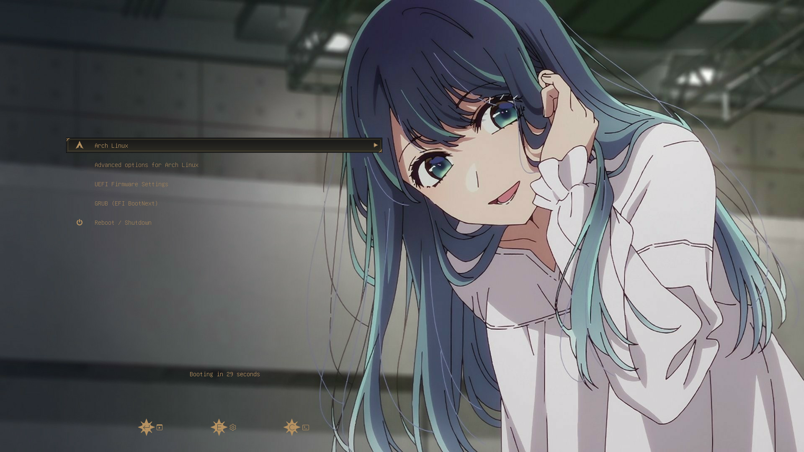
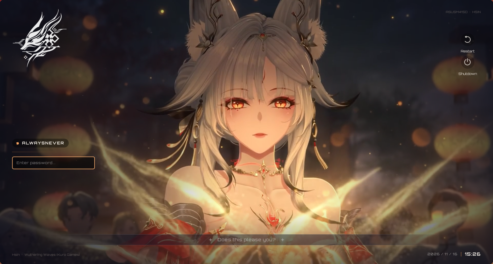
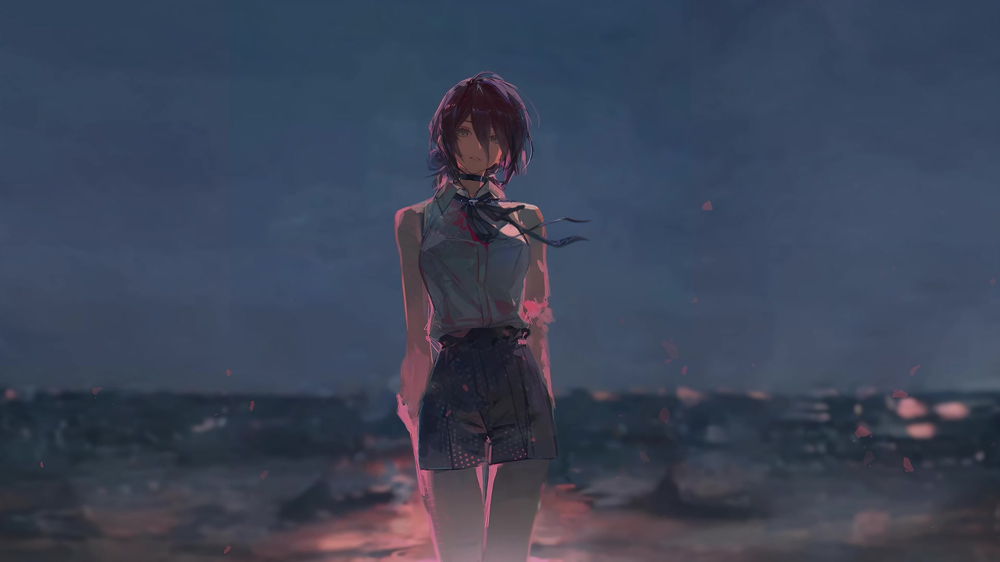
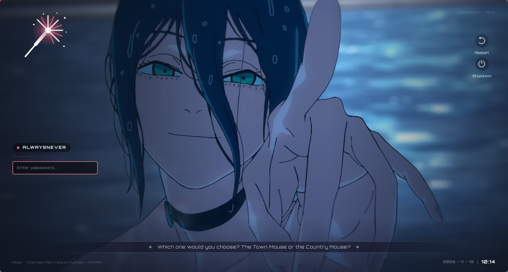

[← README](../README.md)

# Theme gallery

Every theme side by side. Generated by `theme-gallery` from each theme's `theme.ini`; re-run it after adding a theme.

| Theme | From | Accent | Wallpaper | Lock background | Boot visuals |
|-------|------|--------|-----------|-----------------|--------------|
| [Aemeath](#aemeath) | Wuthering Waves | `#b29dff` | still | video loop | GRUB, Plymouth, tuigreet |
| [Akane](#akane) | Oshi no Ko | `#5fcde0` | still | video loop | GRUB, Plymouth, tuigreet |
| [Han Sooyoung](#hansooyoung) | Omniscient Reader's Viewpoint | `#5b93e6` | still | still image | GRUB, Plymouth, tuigreet |
| [Hsin](#hsin) | Wuthering Waves | `#f4a261` | still | video loop | GRUB, Plymouth, tuigreet |
| [Reze](#reze) | Chainsaw Man | `#e0607a` | video | video loop | — |
| [Shorekeeper](#shorekeeper) | Wuthering Waves | `#55a6dc` | still | video loop | GRUB, Plymouth, tuigreet |

## Aemeath

> Did you see me?

**Wallpaper**

**Lock screen**

**Lock background**

**Emblem**

**Boot menu (GRUB)**

**Boot splash (Plymouth)**

## Akane

> I'm on your side, no matter what happens. I'll carry your pain with you, okay?

**Wallpaper**

**Lock screen**

**Lock background**

**Emblem**

**Boot menu (GRUB)**

**Boot splash (Plymouth)**

## Han Sooyoung

> Ultimately, every human is their own writer.

*The art for this theme isn't included in the repository, at the artist's [request](https://x.com/1L9l2Aa8UCL0IGJ/status/1715956739982651511).* See the artist's own posts [here](https://x.com/1L9l2Aa8UCL0IGJ/media).

**Emblem**

**Boot splash (Plymouth)**

## Hsin

> Does this please you?

**Wallpaper**

**Lock screen**

**Lock background**

**Emblem**

**Boot menu (GRUB)**

**Boot splash (Plymouth)**

## Reze

> Which one would you choose? The Town Mouse or the Country Mouse?

**Wallpaper**

**Lock screen**

**Lock background**

**Emblem**

## Shorekeeper

> Worry not. I am here for you.

**Wallpaper**

**Lock screen**

**Lock background**

**Emblem**

**Boot menu (GRUB)**

**Boot splash (Plymouth)**

