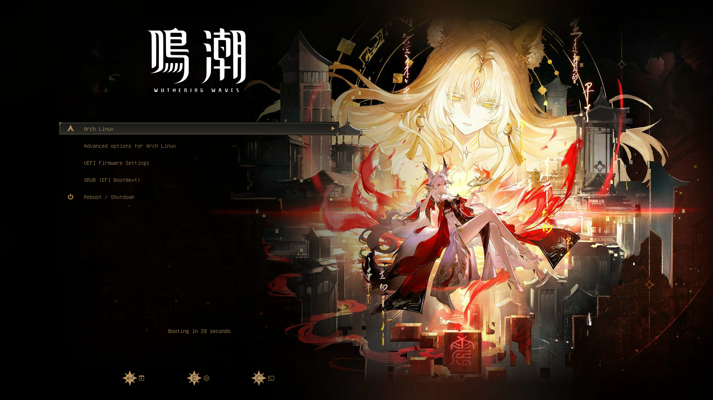
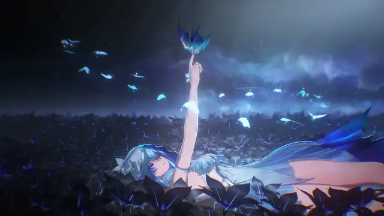
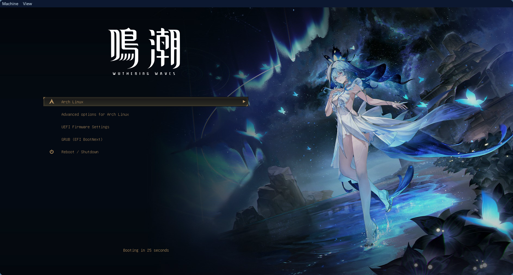

[← README](../README.md)

# Theme gallery

Every theme side by side. Generated by `theme-gallery` from each theme's `theme.ini`; re-run it after adding a theme.

| Theme | From | Accent | Wallpaper | Lock background | Boot visuals |
|-------|------|--------|-----------|-----------------|--------------|
| [Aemeath](#aemeath) (active) | Wuthering Waves | `#b29dff` | still | video loop | GRUB, Plymouth, tuigreet |
| [Hsin](#hsin) | Wuthering Waves | `#f4a261` | still | video loop | GRUB, Plymouth, tuigreet |
| [Reze](#reze) | Chainsaw Man | `#e0607a` | video | video loop | — |
| [Shorekeeper](#shorekeeper) | Wuthering Waves | `#55a6dc` | still | video loop | GRUB, Plymouth, tuigreet |

## Aemeath

> Did you see me?

**Wallpaper**

**Lock screen**

**Lock background**

**Emblem**

**Boot menu (GRUB)**

**Boot splash (Plymouth)**

## Hsin

> Does this please you?

**Wallpaper**

**Lock screen**

**Lock background**

**Emblem**

**Boot menu (GRUB)**

**Boot splash (Plymouth)**

## Reze

> Which one would you choose? The Town Mouse or the Country Mouse?

**Wallpaper**

**Lock screen**

**Lock background**

**Emblem**

## Shorekeeper

> Worry not. I am here for you.

**Wallpaper**

**Lock screen**

**Lock background**

**Emblem**

**Boot menu (GRUB)**

**Boot splash (Plymouth)**

