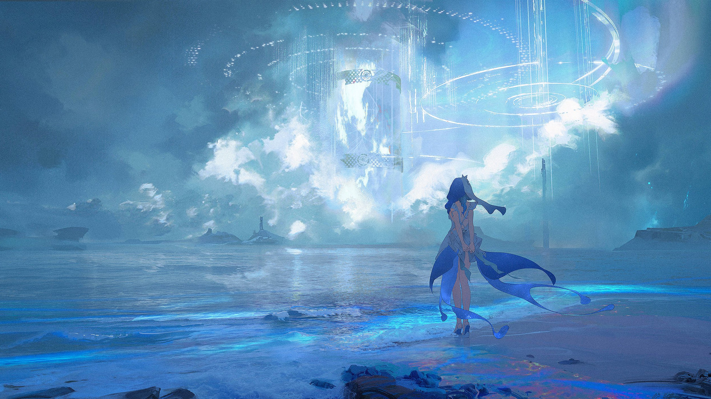
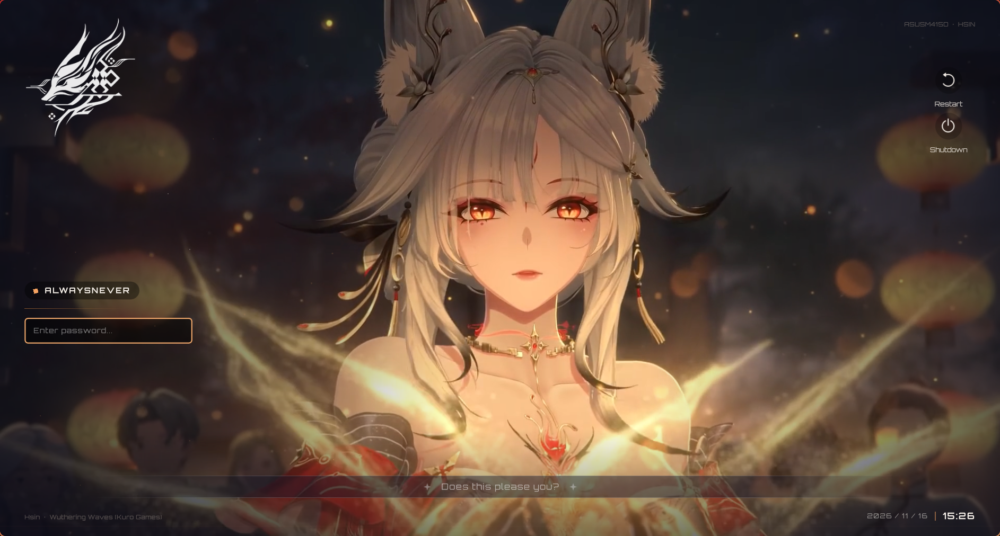
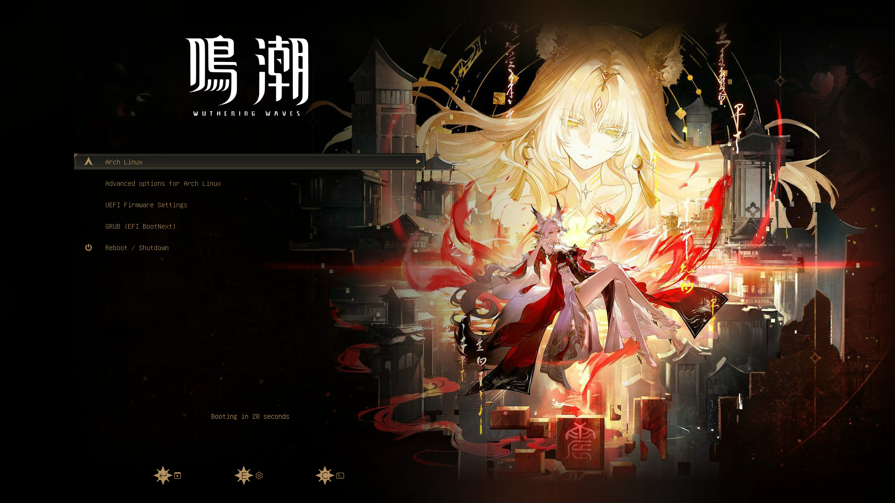

# dotfiles

Dotfiles for my ASUS M415D laptop: Arch Linux + Hyprland, run through uwsm and themed after Wuthering Waves, with switchable desktop themes (Hsin and Shorekeeper).

Hardware: ASUS VivoBook M415DA, AMD Ryzen 3 3250U, Vega 3 graphics, 14 GB RAM, 1080p panel.

## Preview

**Wallpapers** (Hsin and Shorekeeper themes)




**Lock screen** (qylock, Hsin theme)




**Boot menu** (GRUB, Hsin theme)



**Boot splash** (Plymouth, Hsin theme)


## Stack

### Core

| Part | Packages | Notes |
|------|----------|-------|
| OS | `linux`, `linux-lts` | Arch Linux, systemd |
| Bootloader | `grub` | Wuthering theme per desktop theme, quiet boot (`grub-update`) |
| Boot splash | `plymouth` | the theme's emblem fading in and out |
| Login | `greetd`, `greetd-tuigreet` | matrix background in theme colours; session output goes to a log (`quiet-session`) |
| Session | `uwsm` | starts Hyprland and autostart apps as systemd units |
| Compositor | `hyprland` | Lua config |
| Bar | `waybar` | app icons per workspace, icon-only status pill |
| Launcher | `hyprlauncher` | follows the theme |
| Notifications | `dunst` | click opens the app; history on `Super+N` |
| Lock and idle | `quickshell`, `hypridle`, `hyprlock` | qylock with one theme per desktop theme; hyprlock as fallback |
| Wallpaper | `hyprpaper` | |
| Polkit | `hyprpolkitagent` | user service |
| Terminal | `kitty` | |
| Shell | `zsh`, `zsh-autosuggestions`, `zsh-syntax-highlighting` | bash as fallback |
| Theming | `adw-gtk-theme`, `breeze`, `hyprqt6engine` | current theme's palette for GTK and Qt |
| Theme switcher | `python`, `quickshell` | `theme-switch`, picker on `Super+T` (see Themes) |
| Audio | `pipewire`, `wireplumber` | |
| Network | `networkmanager` | |

### Utilities

| Part | Packages | Notes |
|------|----------|-------|
| Files | `dolphin` | |
| Menus | `fuzzel` | Wi-Fi, power, clipboard, notification history |
| Clipboard | `cliphist`, `wl-clipboard` | |
| Screenshots | `grim`, `slurp` | `hypr/screenshot.sh` |
| Images | `imv` | `imv-folder` opens the whole folder |
| Video | `mpv` | uosc and videoclip, installed by hand |
| Calendar | `zenity` | pinned calendar on right-click of the date |
| Bluetooth | `bluez`, `blueman` | |
| Hardware keys | `brightnessctl`, `playerctl` | |
| Snapshots | `timeshift`, `cronie` | rsync, daily |
| Media server | `cifs-utils`, `tailscale` | CIFS automounts |
| System info | `fastfetch` | |

## Palette

Every colour comes from the active theme's `theme.ini` (see Themes).

| Theme | Accent | Secondary | Alert | Background |
|-------|--------|-----------|-------|------------|
| Hsin | amber `#f4a261` | `#a8dedc` | crimson `#d62828` | ink `#12131a` |
| Shorekeeper | sky blue `#55a6dc` | `#9ecbe7` | coral `#e85d75` | deep sea `#0a1424` |

## Theming

GTK uses adw-gtk3 with colour overrides in `gtk.css`. Qt apps (Dolphin included) use `hyprqt6engine` with the current theme's generated `qt.colors` scheme. These settings aren't stored in files, so run them once:

```sh
gsettings set org.gnome.desktop.interface gtk-theme 'adw-gtk3-dark'
gsettings set org.gnome.desktop.interface color-scheme 'prefer-dark'
gsettings set org.gnome.desktop.interface accent-color 'orange'
gsettings set org.gnome.desktop.interface icon-theme 'breeze-dark'
```

`imv-folder.desktop` has my home path hardcoded; edit it on another machine.

## Keybindings

`Super` is the main modifier.

| Keys | Action |
|------|--------|
| `Super+Q` | terminal (kitty) |
| `Super+E` | file manager (Dolphin) |
| `Super+R` | launcher (hyprlauncher) |
| `Super+Shift+F` | Firefox |
| `Super+C` | close window |
| `Super+V` / `Super+P` / `Super+J` | float / pseudo / toggle split |
| `Super+L` | lock screen |
| `Super+M` | log out (`uwsm stop`) |
| `Super+T` / `Super+Shift+T` | theme picker (Quickshell / fuzzel fallback) |
| `Super+1..0` / `Super+Shift+1..0` | go to / move window to workspace |
| `Super+S` | scratchpad workspace |
| `Super+arrows` | move focus |
| `Print` / `Super+Print` / `Super+X` | screenshot: region / full / window |
| `Super+Alt+S` | Syncplay |
| `Super+Shift+V` | media server folder (Dolphin) |
| `Super+Alt+V` | clipboard history |
| `Super+N` | notification history (also: click the bell in Waybar; right-click toggles do not disturb) |
| `Fn+F11` | region screenshot (the key sends `Super+Shift+S`) |
| `Fn+F12` (MyASUS key) | power menu: lock, log out, suspend, reboot, shut down |
| touchpad key | toggle the touchpad |

## Bar

- **Left:** workspaces, shown as the icons of the apps open on them (an empty workspace shows the theme's icon: a fox for Hsin), then media.
- **Center:** time.
- **Right:** RAM, then one pill with brightness, volume, Wi-Fi, battery and tray (icons only, details on hover), then date and notifications.

| Module | Click | Right click | Other |
|--------|-------|-------------|-------|
| Wi-Fi | network menu (fuzzel) | nmtui | |
| Date | year view | pinned calendar (zenity) | scroll: change month, middle click: today |
| Bell | notification history | do not disturb | |

App icons are mapped by window class in `window-rewrite` (`.config/waybar/config.jsonc`). Unknown apps get a generic icon.

## Lock screen

[qylock](https://github.com/Darkkal44/qylock) (Quickshell) with my own themes, one per desktop theme, all built on a config-driven recolour of qylock's Wuthering Waves theme. hypridle, `Super+L`, suspend and the power menu all lock through `loginctl lock-session`. hyprlock is still installed as a fallback.

- **Program:** `~/.local/share/quickshell-lockscreen/` (only the `quickshell-lockscreen` folder from qylock, about 150 KB; the full repo is over 1 GB of themes).
- **Themes:** `~/.local/share/qylock-themes/`, linked in as `themes_link`. `_shared/` holds the common `Main.qml` and font; the per-theme folders are generated by `theme-gen` (video, emblem, `theme.conf`). `theme-switch` writes the active name to `~/.config/qylock/theme`.
- **Backgrounds:** short ping-pong loops (played forward then backward at about 60% speed, 1080p): Hsin from her trailer (4:56–4:57), Shorekeeper from hers (0:16–0:18).

Install the program without the whole repo:

```sh
git clone --depth 1 --filter=blob:none --sparse https://github.com/Darkkal44/qylock /tmp/qylock
git -C /tmp/qylock sparse-checkout set quickshell-lockscreen
cp -r /tmp/qylock/quickshell-lockscreen ~/.local/share/quickshell-lockscreen && rm -rf /tmp/qylock
ln -sfn ~/.local/share/qylock-themes ~/.local/share/quickshell-lockscreen/themes_link
```

To test a theme in a window, without locking:

```sh
XDG_SESSION_TYPE=x11 QS_TESTING=1 ~/.local/share/quickshell-lockscreen/lock.sh
```

If the lock ever goes black: `misc.allow_session_lock_restore` is on, so switch to another console (Ctrl+Alt+F3), run `WAYLAND_DISPLAY=wayland-1 XDG_RUNTIME_DIR=/run/user/1000 hyprlock &`, go back to the session's console and type the password (even if the screen stays black). The usual cause is a theme that failed to load.

**How locking works**

- Every lock goes through `loginctl lock-session`, which runs hypridle's `lock_cmd`: idle after 5 minutes, `Super+L`, the power menu and suspend.
- `lock_cmd = pgrep -f "[l]ock_shell.qml" || uwsm app -- …/lock.sh`. The guard stops a second lock from starting on top of the first, which caused Hyprland's red "lock app died" screen. The `[l]` keeps `pgrep` from matching its own command line.
- `before_sleep_cmd = loginctl lock-session && sleep 6`: the lock takes about 5 seconds to load, so suspend waits for it. That needs `InhibitDelayMaxSec=10` in logind (see the system notes).
- If locking ever stops working, check for a stuck instance with `pgrep -af '[l]ock_shell.qml'` and remove it with `pkill -f '[l]ock_shell.qml'`.

## Packages

### 1. Official packages

```sh
sudo pacman -S hyprland uwsm waybar hyprpaper hypridle hyprlock hyprlauncher \
  hyprpolkitagent dunst kitty zsh zsh-autosuggestions zsh-syntax-highlighting \
  grim slurp wl-clipboard jq libnotify brightnessctl playerctl wireplumber \
  pavucontrol bluez blueman power-profiles-daemon mpv dolphin firefox \
  fastfetch ttf-jetbrains-mono-nerd greetd greetd-tuigreet cifs-utils \
  timeshift cronie syncplay steam adw-gtk-theme breeze imv fuzzel cliphist zenity plymouth python
```

`steam` needs the `multilib` repo enabled in `/etc/pacman.conf`.

### 2. An AUR helper

The AUR packages below need a helper. I use [`yay`](https://github.com/Jguer/yay); [`paru`](https://github.com/Morganamilo/paru) works the same way. Both are built by hand once, then manage everything else:

```sh
sudo pacman -S --needed git base-devel

# yay
git clone https://aur.archlinux.org/yay-bin.git
cd yay-bin && makepkg -si

# or paru
git clone https://aur.archlinux.org/paru-bin.git
cd paru-bin && makepkg -si
```

### 3. AUR packages

```sh
yay -S vesktop akyuu parsec-bin vita3k-git ttf-orbitron hyprqt6engine quickshell
```

(`paru -S` takes the same arguments.)

| Package | Used for |
|---------|----------|
| `vesktop` | Discord client (autostart, `discord://` links) |
| `akyuu` | anime tracker, a Taiga fork for Linux ([ligneo/akyuu](https://github.com/ligneo/akyuu)) |
| `parsec-bin` | remote desktop |
| `vita3k-git` | PS Vita emulator (fullscreen window rule) |
| `ttf-orbitron` | font (lock screen clock, theme picker) |
| `quickshell` | lock screen and theme picker |
| `hyprqt6engine` | Qt theme engine (Dolphin and other Qt apps follow the theme's `qt.colors`) |

The mpv scripts `uosc` and `videoclip` are installed by hand.

## Layout

This is a bare repo whose work tree is `$HOME`.

```sh
alias config='git --git-dir=$HOME/.cfg --work-tree=$HOME'
config status
config add <file>
config commit -m "..."
config push
```

Untracked files are hidden (`status.showUntrackedFiles no`), so new configs have to be added by hand.

## Install on a new machine

```sh
git clone --bare git@github.com:alwaysneverr/dotfiles.git $HOME/.cfg
alias config='git --git-dir=$HOME/.cfg --work-tree=$HOME'
config checkout
config config status.showUntrackedFiles no
sudo install -m 755 ~/.config/themes/theme-boot /usr/local/bin/
theme-switch hsin
```

`theme-switch` builds the generated files that aren't tracked (`gen/`, `current`, the lock theme folders).

If checkout complains about existing files, move them aside and retry.

## What's tracked

| Path | What it is |
|------|------------|
| `.config/hypr/hyprland.lua` | Hyprland config (Lua): autostart, binds, window rules, animations |
| `.config/hypr/hypridle.conf` | idle actions: dim, power saver, lock, suspend |
| `.config/hypr/hyprlock.conf` | lock screen |
| `.config/hypr/hyprpaper.conf` | wallpaper |
| `.config/hypr/hyprtoolkit.conf` | shared theme for Hypr apps (link to the theme's generated file) |
| `.config/hypr/screenshot.sh` | screenshot script (grim + slurp, with notification) |
| `.config/hyprlauncher/style.css` | launcher theme |
| `.config/waybar/` | bar config and style (see Bar) |
| `.local/bin/wifi-menu` | Wi-Fi picker (nmcli + fuzzel) |
| `.config/fuzzel/fuzzel.ini` | menu theme |
| `.local/bin/power-menu` | power menu (fuzzel) |
| `.local/bin/clip-menu` | clipboard history picker (cliphist + fuzzel) |
| `.local/bin/notif-center`, `.local/bin/notif-status` | notification history picker and Waybar bell |
| `.local/bin/touchpad-toggle` | touchpad on/off (`hyprctl eval hl.device`) |
| `.local/bin/grub-update` | rebuild `grub.cfg` without the "Loading…" lines |
| `.config/themes/` | themes: `theme.ini`, wallpaper, emblem, lock video, GRUB image, quotes; copy of `theme-boot` |
| `.local/bin/theme-*` | `theme-gen`, `theme-switch`, `theme-list`, pickers, one-time migration scripts |
| `.config/quickshell/theme-picker/` | Quickshell theme picker |
| `.local/share/qylock-themes/_shared/` | shared lock screen QML and font |
| `.local/share/plymouth-themes/hsin/` | backup of the Plymouth theme |
| `.config/dunst/dunstrc`, `.config/dunst/dunstrc.d/` | notifications (theme colours via `dunstrc.d`) |
| `.config/kitty/kitty.conf` | terminal |
| `.config/fastfetch/config.jsonc` | system info |
| `.config/uwsm/env` | session environment (DPI scaling, Qt theme) |
| `.config/mpv/` | `mpv.conf`, `input.conf`, `script-opts/` |
| `.config/mimeapps.list` | default applications |
| `.config/gtk-3.0/gtk.css`, `.config/gtk-4.0/gtk.css` | GTK colour overrides |
| `.config/hypr/hyprqt6engine.conf` | Qt theme (colour scheme, icons, style) |
| `.config/imv/config` | image viewer colours |
| `.local/bin/imv-folder`, `.local/share/applications/imv-folder.desktop` | opens an image with its whole folder loaded |
| `.zshrc`, `.bashrc` | shell config, aliases, prompt |

mpv scripts (`uosc`, `videoclip`) and fonts are not tracked. Reinstall them by hand.

## System-level notes (outside this repo)

- **greetd:** `/etc/greetd/config.toml` runs `tuigreet` with `--remember --remember-session`, the session list from `/usr/share/wayland-sessions`, a matrix background, and colours that `theme-boot` sets per theme. Logging in through uwsm is what makes autostart apps start. Sessions start through `/usr/local/bin/quiet-session` (tuigreet `--session-wrapper`), which sends uwsm's startup output to `~/.local/state/session-start.log` instead of the screen.
- **Snapshots:** Timeshift (rsync) on the root partition, `/home` excluded. `/boot` is a separate FAT partition, so a pacman hook (`95-bootbackup.hook`) copies it to `/.bootbackup` on every kernel change, and Timeshift picks that up.
- **Cleanup routine:** `paccache.timer` is enabled, plus `fstrim.timer` and `reflector` for mirrors.
- **Polkit agent:** `hyprpolkitagent` is enabled as a user service (`systemctl --user enable hyprpolkitagent`).
- **Media server:** two CIFS automounts in `/etc/fstab` (`~/M710q/Videos`, `~/M710q/Documents`) over Tailscale, with `vers=3.1.1`. The credentials live in `~/.smbcredentials` (mode 600, not tracked).
- **GRUB:** Wuthering-hsin theme in `/boot/grub/themes/Wuthering-hsin` (copied from my E420; based on [vinceliuice/Wuthering-grub2-themes](https://github.com/vinceliuice/Wuthering-grub2-themes), edited by me). `theme-boot` copies it as `Wuthering-<theme>` with the theme's `grub.jpg`. In `/etc/default/grub`: `GRUB_THEME` points at its `theme.txt`, `GRUB_GFXMODE=1920x1080,auto`, and `GRUB_CMDLINE_LINUX_DEFAULT="quiet loglevel=3 rd.udev.log_level=3 udev.log_level=3 vt.global_cursor_default=0 splash"` for a quiet boot. Rebuild with `grub-update` (not `grub-mkconfig`), which also strips the "Loading…" lines.
- **Watchdog:** `sp5100_tco` is blacklisted (`/etc/modprobe.d/no-watchdog.conf`) to silence "watchdog did not stop" at shutdown.
- **Plymouth:** custom script theme (the emblem fading in and out on black), installed in `/usr/share/plymouth/themes/hsin`; `theme-boot` copies it per theme with that theme's `logo.png`. A copy is kept in `.local/share/plymouth-themes/hsin`. Set up with: the `plymouth` hook after `systemd` in `/etc/mkinitcpio.conf` (with `kms` for early graphics), `splash` in the kernel options, and `/etc/systemd/system/greetd.service.d/plymouth.conf` (`After=plymouth-quit.service plymouth-quit-wait.service`) so the greeter waits for the splash. After editing the theme, run `sudo mkinitcpio -P`.
- **Theme switcher:** `/usr/local/bin/theme-boot` (root, via pkexec) switches GRUB, Plymouth and tuigreet for `theme-switch NAME --boot`. A copy is kept in `.config/themes/theme-boot`.
- **logind:** `/etc/systemd/logind.conf.d/lock-delay.conf` sets `InhibitDelayMaxSec=10`, so hypridle can hold suspend until the lock screen is up.

## Launcher icons

hyprtoolkit 0.6.0 has two icon bugs: absolute `Icon=` paths that include a file extension fail ([hyprlauncher#152](https://github.com/hyprwm/hyprlauncher/issues/152)), and icons in `~/.local/share/icons` are missed (fixed upstream in [hyprtoolkit#157](https://github.com/hyprwm/hyprtoolkit/pull/157), not released yet). Fixes used here:

- Copy the app's `.desktop` file to `~/.local/share/applications/` and set `Icon=` to a theme icon name.
- Steam game icons live in `~/.local/share/icons/hicolor`; symlink them into `/usr/share/icons/hicolor` (see the loop in my notes) after adding a game. Not needed once hyprtoolkit 0.6.0 is replaced by a newer release.
- Hide clutter (Wine entries and similar) with `NoDisplay=true` in a local copy.

## Themes

The whole desktop switches between themes at once: colours, wallpaper, lock screen, prompt and fastfetch. GRUB, Plymouth and tuigreet can optionally switch too. Two themes ship: **Hsin** (amber on navy) and **Shorekeeper** (sky blue on deep sea), both from Wuthering Waves.

### Switching

After a fresh clone, run `theme-switch hsin` once: generated files (`gen/`, `current`, lock theme folders) are not tracked.

| How | What |
|---|---|
| `Super+T` | Quickshell picker with wallpaper previews, palette swatches and taglines. `←/→` to choose, `Enter` to apply, `Shift+Enter` to apply with boot visuals, `Esc` to close |
| `Super+Shift+T` | fuzzel picker (fallback if Quickshell breaks) |
| `theme-switch` | List themes (`*` marks the current one) |
| `theme-switch NAME` | Switch the desktop |
| `theme-switch NAME --boot` | Also switch GRUB, Plymouth and tuigreet (asks for your password, takes about 30 s) |

Kitty, Waybar, Dunst, fuzzel, Hyprland, hyprpaper, hyprlauncher and GTK apps reload live. Qt apps (Dolphin) update after a restart. Shells update at the next prompt.

### How it works

```
~/.config/themes/
├── current -> hsin            active theme (symlink)
├── hsin/
│   ├── theme.ini              palette, ANSI colours, lock texts, boot theme names
│   ├── wallpaper.jpg  logo.png  lock.mp4  quotes.txt  grub.jpg
│   └── gen/                   generated by theme-gen, don't edit
└── shorekeeper/
```

- Each app's config **includes** a file from `current/gen/` (`kitty.conf`, `waybar.css`, `dunst.conf`, `fuzzel.ini`, `hyprlock.conf`, `hyprland.lua`, `gtk.css`, `qt.colors`, `prompt.sh`…), so switching is just regenerating and moving the symlink.
- Waybar's `config.jsonc` (calendar colours, empty-workspace icon) and fastfetch's config are edited in place.
- The lock screen (qylock) gets a theme folder in `~/.local/share/qylock-themes/<name>/` that shares one config-driven `Main.qml` and font; only the video, emblem and `theme.conf` differ.
- `theme-boot` (runs as root via pkexec) copies the GRUB and Plymouth themes, swaps in `grub.jpg` and the emblem, edits tuigreet's colours, then runs `grub-mkconfig` and `mkinitcpio -P`.

| Script | Job |
|---|---|
| `theme-gen` | Writes `gen/*` and the qylock theme from `theme.ini` |
| `theme-switch` | Runs theme-gen, moves the symlink, reloads apps |
| `theme-list` | Prints all themes as JSON for the Quickshell picker |
| `theme-picker-qs` / `theme-picker` | The two pickers |
| `/usr/local/bin/theme-boot` | Boot visuals (root) |

### Adding a theme

1. `cp -r ~/.config/themes/shorekeeper ~/.config/themes/NAME`, then delete its `gen/`.
2. Edit `theme.ini`: `[meta]` name and boot theme names, `[colors]`, `[ansi]`, `[lock]` texts.
3. Replace `wallpaper.jpg` (16:9), `logo.png` (emblem, ~256 px, transparent), `lock.mp4` (1080p loop), `grub.jpg` (1920×1080, baseline JPEG) and `quotes.txt`.
4. `theme-switch NAME`, then `theme-switch NAME --boot` once happy.

## Credits

- **Hsin**, **Shorekeeper** and all Wuthering Waves material belong to Kuro Games, used here for personal customization:
  - the Hsin wallpaper;
  - the lock screen background, a loop cut from the Hsin trailer;
  - the voice-line quotes on the hyprlock fallback (both characters);
  - the Mengzhou emblem (the fox logo);
  - the Shorekeeper wallpaper (Tethys) and the Black Shores emblem;
  - the Shorekeeper lock screen background, a loop cut from her trailer.
- **Lock screen:** based on the Wuthering Waves theme from [qylock](https://github.com/Darkkal44/qylock) by Darkkal44 (recoloured and edited by me), with its Orbitron font.
- **GRUB theme:** based on [Wuthering-grub2-themes](https://github.com/vinceliuice/Wuthering-grub2-themes) by vinceliuice, edited by me.
