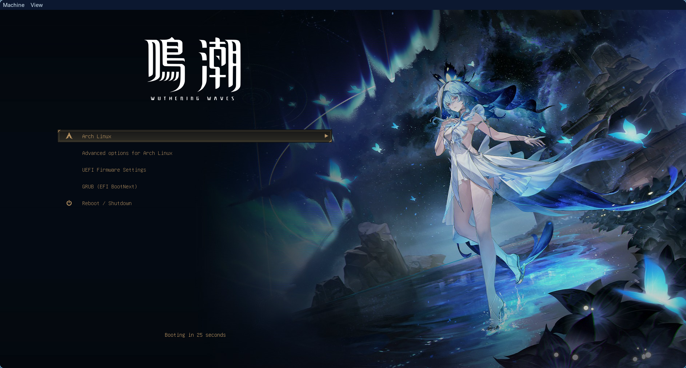

# dotfiles

Dotfiles for my ASUS M415D laptop: Arch Linux + Hyprland, run through uwsm and themed after Wuthering Waves, with switchable desktop themes (Hsin, Shorekeeper, Aemeath and Reze).

Hardware: ASUS VivoBook M415DA, AMD Ryzen 3 3250U, Vega 3 graphics, 14 GB RAM, 1080p panel.

## Preview

Shown: **Shorekeeper**. Every theme: [theme gallery](.docs/gallery.md).

**Wallpaper**


**Lock screen**


**Lock background**


**Boot menu (GRUB)**



**Boot splash (Plymouth)**


## At a glance

- **Hyprland** (Lua config) through **uwsm**, autologin with **greetd** that boots straight into the lock screen
- **Switchable themes** (Hsin, Shorekeeper, Aemeath, Reze): one command or `Super+T` recolours the desktop, lock screen, shell and fastfetch, and optionally GRUB, Plymouth and the greeter
- **Animated wallpapers:** video (mpvpaper) or GIF (awww) per theme, with a transition on every switch; `Super+Shift+W` toggles to the still image
- **Quickshell** lock screen (qylock) and theme picker, **Waybar** with app icons per workspace, **fuzzel** menus for Wi-Fi, power, clipboard and notifications
- Quiet boot: themed GRUB, Plymouth splash, no console text

## Docs

| Doc | What's in it |
|-----|--------------|
| [Stack](.docs/stack.md) | every part and the packages behind it |
| [Themes](.docs/themes.md) | switching, how it works, options, adding a theme, palettes |
| [Gallery](.docs/gallery.md) | every theme compared: palettes, wallpapers, lock screens, boot visuals |
| [Desktop](.docs/desktop.md) | GTK/Qt setup, keybindings, bar, launcher icon fixes |
| [Lock screen](.docs/lock-screen.md) | qylock setup, how locking works, recovery |
| [Install](.docs/install.md) | packages, bare repo layout, new machine, what's tracked |
| [System notes](.docs/system.md) | greetd, GRUB, Plymouth, logind and other changes outside `$HOME` |

## Quick start

```sh
git clone --bare git@github.com:alwaysneverr/dotfiles.git $HOME/.cfg
alias config='git --git-dir=$HOME/.cfg --work-tree=$HOME'
config checkout && config config status.showUntrackedFiles no
theme-switch hsin
```

Install the packages first and see [Install](.docs/install.md) for the full steps.

## Credits

Character art, footage and voice lines belong to their owners and are used here for personal customization.

**Official art and game assets**

- **Hsin** (Wuthering Waves, © Kuro Games): Mengzhou emblem (the fox logo), lock screen loop cut from official footage, and voice-line quotes.
- **Shorekeeper** (Wuthering Waves, © Kuro Games): Tethys wallpaper, official art by void_0 ([pixiv](https://www.pixiv.net/en/artworks/124007525), [official post](https://x.com/Wuthering_Waves/status/1842776797504516473)); Black Shores emblem, lock screen loop cut from her trailer, and voice-line quotes.
- **Aemeath** (Wuthering Waves, © Kuro Games): wallpaper, official art for the 环宇穹音 theme gift box by 一颗大脆桃桃 ([rednote](https://www.xiaohongshu.com/explore/6ab89408000000001402c3c5), [Kuro Games merch post](https://www.bilibili.com/opus/1180739616989249541)); splash art (GRUB background), emblem, lock screen loop cut from her trailer, and voice-line quotes.
- **Reze** (Chainsaw Man, © Tatsuki Fujimoto / Shueisha): lock screen loop cut from the MAPPA anime, and voice-line quotes. The sparkler emblem is my own.
- **Akane Kurokawa** (Oshi no Ko, © Aka Akasaka / Mengo Yokoyari / Shueisha): lock screen loop and GRUB background from the Doga Kobo anime, and quotes. The star emblem and its Plymouth spin are my own.

**Fan art**

- **Hsin** wallpaper by 若干爪 ([X](https://x.com/ruoganzhua/status/2075434349735137326)).
- **Reze** "Last Summer" wallpaper by doveop ([X](https://x.com/Weidudoveop503/status/1977583658983928128), [pixiv](https://www.pixiv.net/en/artworks/137326451)); the animated widescreen version comes from vsthemes.org.
- **Akane Kurokawa** wallpaper by Lilac ([X](https://x.com/a_Lil4c), [pixiv](https://www.pixiv.net/en/users/13457305)).

**Built on**

- **Lock screen:** based on the Wuthering Waves theme from [qylock](https://github.com/Darkkal44/qylock) by Darkkal44 (recoloured and edited by me), with its Orbitron font.
- **GRUB theme:** based on [Wuthering-grub2-themes](https://github.com/vinceliuice/Wuthering-grub2-themes) by vinceliuice, edited by me.
